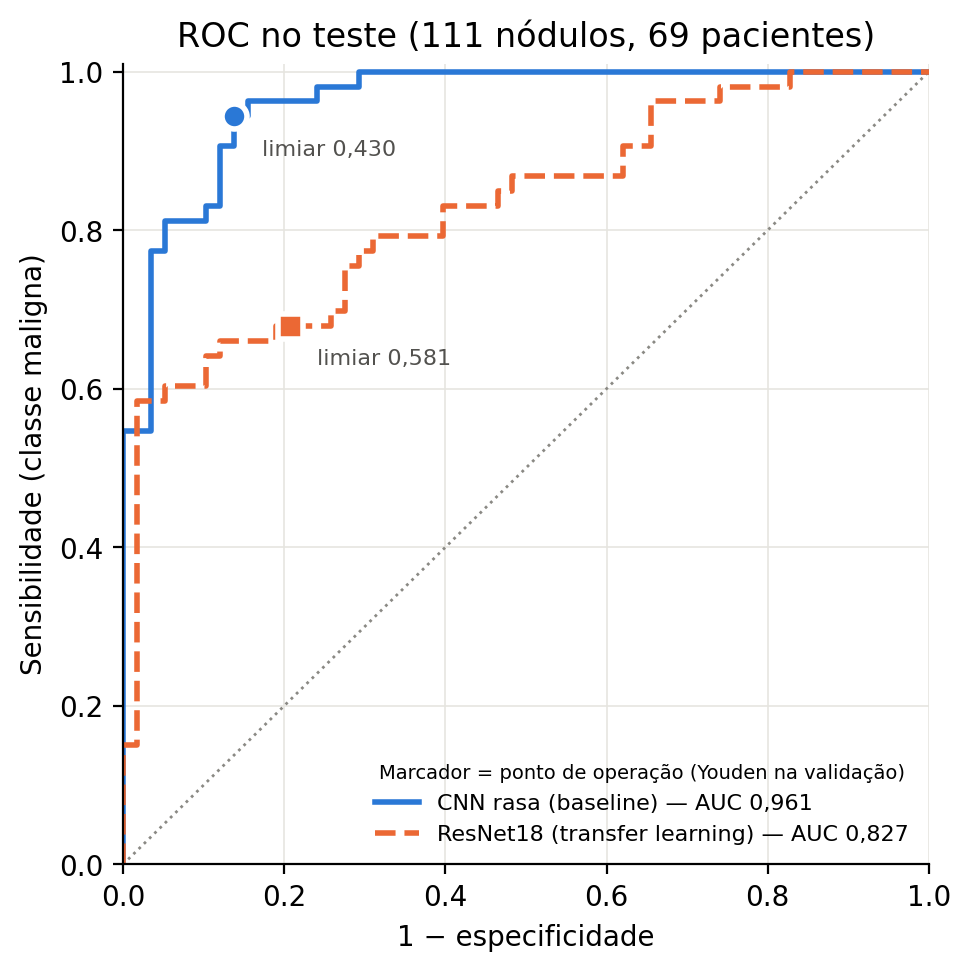

# Comparação baseline × ResNet — Issue #18

Números gerados por `python -m mineracao.comparacao` (seed 42, 2000 réplicas de
bootstrap). Saídas em `mineracao/resultados/comparacao/`: `tabela_comparativa.md`,
`resultados.json`, `roc_comparacao.png` e `predicoes_teste_pareadas.csv`.
O script não treina nem prevê: lê as predições de teste e os thresholds
congelados nos logs da #14 e da #17, confere tudo e só então calcula.

## 1. Conferência: os dois modelos foram avaliados do mesmo jeito

| Item | Baseline (#14) | ResNet (#17) |
|---|---|---|
| SHA-256 do `.npz` no log | `31a84904c9c39c97d362c46cbfef353afaecf3f531e68a90c1bfbf51d2a73fdd` | `31a84904c9c39c97d362c46cbfef353afaecf3f531e68a90c1bfbf51d2a73fdd` |
| Manifesto lido no log | `transformacao/manifest_patches.csv` | `transformacao/manifest_patches.csv` |
| Teste | 111 nódulos, 69 pacientes (53 malignos, 58 benignos) | idem, mesmos `nodule_id` |
| Threshold (Youden na validação) | 0,4305 | 0,5812 |
| Avaliações de teste no log | 1 | 1 |

- **Hash do `.npz`:** idêntico nos dois logs e igual ao `patches/patches_2_5d.npz`
  atual. A comparação vale.
- **Split:** os dois scripts leem o split da coluna `split` do manifesto via
  `mineracao/dataset.carregar_particoes`, sem sorteio próprio. O script de
  comparação passa as duas tabelas por `validar_com_manifesto` e exige que
  cubram exatamente os 111 nódulos de teste do manifesto, com os mesmos
  pacientes e rótulos. Os logs registram o caminho do manifesto, não o hash;
  o SHA-256 do manifesto atual (`207f44c7…16e4e0`) está em `resultados.json`.
- **CSV × log:** as métricas recalculadas de cada `predicoes_teste.csv` com o
  threshold do log batem exatamente com a linha `TESTE` do mesmo log, o que
  garante que predição e threshold vêm da mesma execução.
- **Teste usado uma vez:** cada modelo foi avaliado no teste uma única vez, com
  arquitetura, época e threshold congelados na validação. Este script só lê as
  predições gravadas; não reabre o teste.

> **Origem das predições do baseline.** A #14 não deixou `predicoes_teste.csv`
> no repositório (`mineracao/resultados/` está no `.gitignore`). As predições
> foram geradas nesta issue com a configuração padrão congelada da #14 —
> `python -m mineracao.treino_baseline --liberado-11 --npz patches/patches_2_5d.npz --avaliar-teste`
> (pesos de classe, flip 3D só no treino, 30 épocas, seed 42), que é a mesma
> configuração de perda e augmentation da ResNet. Nenhuma escolha foi feita
> olhando o teste. Ambiente: Python 3.13.2, torch 2.11.0 (CPU); o docstring da
> #14 cita torch 2.14.1, então pequenas diferenças numéricas são possíveis se
> outra pessoa reexecutar.

## 2. Decisão sobre independência (ameaça T7)

Os 111 nódulos vêm de 69 pacientes; 25 pacientes têm mais de um nódulo e
concentram 67 nódulos (até 6 em um paciente). **A análise agrega por paciente**:

- IC 95% de cada métrica: bootstrap percentil reamostrando pacientes
  (`avaliacao.bootstrap_por_paciente`, #15).
- IC 95% das diferenças: bootstrap **pareado** por paciente — o mesmo sorteio
  de pacientes é aplicado aos dois modelos em cada réplica.
- McNemar: versão para pares em cluster de Durkalski et al. (2003), com o
  paciente como cluster.
- DeLong: versão em cluster de Obuchowski (1997), que soma os componentes
  estruturais por paciente; reduz ao DeLong usual quando cada paciente tem um
  nódulo.

As versões por nódulo (McNemar exato e DeLong de 1988) aparecem só como
referência, marcadas como tais, porque assumem independência entre nódulos.

## 3. Tabela comparativa (teste, IC 95% por paciente)

Recall e especificidade estão no ponto de operação de cada modelo
(threshold de Youden escolhido na validação e congelado).

| Métrica | CNN rasa (baseline) | ResNet18 (transfer learning) | Diferença (ResNet − baseline) |
|---|---|---|---|
| Recall (maligno) | 0,943 [0,878; 1,000] | 0,679 [0,556; 0,803] | -0,264 [-0,375; -0,148] |
| Especificidade | 0,862 [0,765; 0,946] | 0,793 [0,684; 0,885] | -0,069 [-0,177; 0,035] |
| F1 | 0,901 [0,835; 0,951] | 0,713 [0,604; 0,810] | -0,188 [-0,285; -0,103] |
| AUC-ROC | 0,961 [0,927; 0,986] | 0,827 [0,743; 0,900] | -0,134 [-0,215; -0,060] |
| Limiar (Youden, validação) | 0,4305 | 0,5812 | — |
| TP / FN / TN / FP | 50 / 3 / 50 / 8 | 36 / 17 / 46 / 12 | — |

Todas as réplicas (2000/2000) foram válidas para todas as métricas.

## 4. Testes pareados

| Teste | Estatística | p-valor |
|---|---|---|
| **McNemar em cluster por paciente** (principal) | X² = 11,57; 22 nódulos só o baseline acerta, 4 só a ResNet; 22 pacientes discordantes | **0,0007** |
| McNemar exato por nódulo (referência) | b = 22, c = 4 | 0,0005 |
| **DeLong em cluster por paciente** (principal) | ΔAUC = −0,134, EP 0,039, IC 95% [−0,211; −0,057], z = −3,40 | **0,0007** |
| DeLong por nódulo (referência) | ΔAUC = −0,134, EP 0,037, z = −3,59 | 0,0003 |

O erro-padrão em cluster é maior que o por nódulo, como esperado com nódulos
correlacionados no mesmo paciente. O IC do DeLong em cluster coincide com o do
bootstrap pareado por paciente ([−0,215; −0,060]).

## 5. Curva ROC

Os marcadores são o ponto de operação de cada modelo (círculo: baseline;
quadrado: ResNet).

## 6. Comparação com a literatura — com ressalva

> **Ressalva obrigatória.** Nosso conjunto exige que o nódulo tenha sido marcado
> por **pelo menos 3 radiologistas** e **exclui a malignidade mediana 3**. Os
> casos ambíguos saem do problema, que fica mais fácil do que o reportado em
> trabalhos sobre o LIDC completo. O alvo também é a opinião radiológica, não
> histopatologia. Números da literatura não são diretamente comparáveis.

| Estudo | Conjunto e rótulo | Divisão | Resultado publicado |
| :--- | :--- | :--- | :--- |
| CAUSEY et al. (2018), *Sci. Rep.* 8:9286 — NoduleX | LIDC; média dos escores arredondada; nota 3 excluída; um nódulo sorteado por paciente + 206 nódulos adicionais nota 1 para balanceamento | 80/20 por paciente, partição única | CNN47: AUC 0,974 (S1×S45) e 0,938 (S12×S45); com radiômica (RF): CNN21+RF AUC 0,971 e CNN47+RF AUC 0,943 em S12×S45 |
| AL-SHABI; LEE; TAN (2019), *IEEE Access* — Gated-Dilated | LIDC-IDRI, > 1000 exames | Ver artigo | AUC > 0,95 (resumo) |
| SHANSHOOL; BOUCHAKWAB; AMOUS-BEN AMOR (2023), *Procedia Comput. Sci.*, v. 225, p. 394–403 | LIDC-IDRI (1.018 exames, 244.527 imagens). Rótulo binário: benigno (0) e maligno (1) | 60% treino, 20% validação e 20% teste (Seção 4, p. 399; Tabela 1, p. 400) | DenseNet201 + MLP (Modelo Proposto): Acurácia de 99,30%, Sensibilidade de 99,00% e Especificidade de 99,59% (Seção 4, p. 401; Tabela 2, p. 401) |
| SHEWAYE; MEKONNEN (2016), *arXiv:1605.08350* — AdaBoost (Atributos Heterogêneos) | LIDC-IDRI (95 pacientes, 565 fatias 2D: 458 malignas / 107 benignas). Rótulo clínico/histológico (1 vs. 2-3); rótulo 0 (desconhecido) excluído | Aparentemente por fatia (não explicitado). *Alerta metodológico:* caso a divisão tenha sido feita por fatia, fatias do mesmo nódulo podem vazar entre o treino e o teste, inflando a métrica de AUC para 0,94 | AdaBoost (D=5): AUC 0,94 e Acurácia 0,84 (Tabela III, p. 5; Seção V-D, p. 5) |
| DEY et al. (2018), **IEEE ISBI** — 3D MoDenseNet | LIDC-IDRI (686 nódulos 3D). Mediana dos radiologistas: < 3 (benigno) e > 3 (maligno); nota 3 excluída | 5-fold CV; partição não informada | 3D MoDenseNet: Acurácia de 90,40% e ROC-AUC 0,9548 (Tabela 1, p. 4; Seção 3.3, p. 5) |

O baseline (AUC 0,961) está na mesma faixa desses trabalhos, mas as diferenças metodológicas impedem dizer que ele 'empata' diretamente. Enquanto o desenho de Causey et al. utiliza divisões como 1 × 4–5 ou 1–2 × 4–5, o trabalho de Dey et al. (2018) constitui a referência mais próxima e diretamente comparável ao nosso estudo, pois adota exatamente o mesmo critério de rótulo (avaliação por >= radiologistas, utilização da mediana e exclusão da nota 3). Além disso, vale ressaltar que muitos trabalhos sobre a LIDC dividem os dados por nódulo e não por paciente, o que pode inflar artificialmente o desempenho reportado.

## 7. Texto para a seção de Resultados

> No conjunto de teste (111 nódulos de 69 pacientes; 53 malignos), a CNN rasa
> obteve AUC-ROC de 0,961 (IC 95%: 0,927–0,986) e, no limiar escolhido na
> validação, recall de 0,943 (0,878–1,000) para a classe maligna com
> especificidade de 0,862 (0,765–0,946) e F1 de 0,901 (0,835–0,951). A ResNet18
> pré-treinada no ImageNet, com o extrator congelado, obteve AUC-ROC de 0,827
> (0,743–0,900), recall de 0,679 (0,556–0,803), especificidade de 0,793
> (0,684–0,885) e F1 de 0,713 (0,604–0,810). Todos os intervalos foram obtidos
> por bootstrap reamostrando pacientes. Os dois modelos foram treinados sobre o
> mesmo arquivo de patches (SHA-256 conferido nos dois registros de execução)
> e avaliados no mesmo split, definido por paciente.
>
> Como os modelos foram avaliados nos mesmos nódulos, a comparação foi pareada
> e agregada por paciente para respeitar a dependência entre nódulos do mesmo
> indivíduo. A diferença de AUC (ResNet − CNN rasa) foi de −0,134 (IC 95%:
> −0,211 a −0,057; DeLong em cluster, p < 0,001). No ponto de operação, o
> baseline acertou 22 nódulos que a ResNet errou e a ResNet acertou 4 que o
> baseline errou (McNemar em cluster, p < 0,001). A diferença concentrou-se na
> sensibilidade (−0,264; IC 95%: −0,375 a −0,148); a diferença de
> especificidade (−0,069; −0,177 a 0,035) não foi distinguível de zero.
>
> Não houve evidência de que o transfer learning, na configuração avaliada
> (extrator congelado e apenas a camada linear final treinada), ajude neste
> tamanho de amostra; ao contrário, a CNN rasa treinada do zero foi superior.
> Os resultados devem ser lidos à luz da seleção adotada: ao exigir consenso de
> pelo menos três radiologistas e excluir a malignidade mediana 3, o conjunto
> remove os casos ambíguos e é mais fácil que o LIDC-IDRI completo, de modo que
> os valores não são diretamente comparáveis aos de trabalhos que usam outros
> critérios.

## 8. Piso do diâmetro

Quando usamos só o tamanho do nódulo (`diametro_mm`), sem olhar a imagem,
a AUC no teste já é 0,9463. Esse é o **piso do diâmetro**: é o
mínimo que um modelo com imagem precisa superar para mostrar que a imagem
ajudou. Aqui o diâmetro é usado direto como nota (quanto maior, mais
provável de ser maligno). Não tem treino.

| Modelo | Usa imagem? | AUC-ROC (teste) |
|---|---|---|
| Diâmetro sozinho (`diametro_mm`) | Não | 0,9463 |
| ResNet18 congelada | Sim | 0,8269 |
| CNN 2.5D (baseline) | Sim | 0,9610 |

Usamos quatro casas decimais porque a diferença entre o CNN e o diâmetro é
de só 0,015 e ela some com três casas. A ResNet ficou abaixo do diâmetro e o
CNN ficou um pouco acima. Nenhuma dessas duas comparações com o diâmetro foi
testada estatisticamente.

**Por que o diâmetro vai tão bem (causa provável).** O rótulo vem da mediana
da suspeita dos radiologistas, e o tamanho é um dos critérios que eles usam
para suspeitar de um nódulo. Nos dados dá para ver: a mediana é 7,5 mm nos
benignos e 17,1 mm nos malignos (747 nódulos). Então parte do que o modelo
"aprende" pode ser só tamanho. Isso é uma explicação provável, e não foi
provada.

**Conclusão.** O CNN ganhou só 0,015 do diâmetro. Além disso, o intervalo de
confiança do CNN (0,9270 a 0,9862) é largo e o 0,9463 cai dentro dele. Por
isso, não dá para saber se esse ganho é real ou só sorte da amostra. O que os
dados permitem dizer é que o modelo **não ficou abaixo do piso do diâmetro**.
O que os dados **não** permitem dizer é que o modelo aprendeu textura ou algo
além do tamanho.

**O que resolveria a dúvida.** Um teste que compare a AUC do CNN com a AUC do
diâmetro nos mesmos nódulos do teste (111 nódulos de 69 pacientes), agrupando
por paciente, porque nódulos do mesmo paciente não são independentes. O método 
planejado é o DeLong em cluster por paciente (Obuchowski, 1997), o mesmo da
seção 4. A regra de decisão foi definida antes de ver o resultado: se o 
intervalo de confiança da diferença (CNN − diâmetro) não incluir o zero, há
evidência de que o CNN usa algo além do diâmetro. Se incluir o zero, não há.
 **Este teste não foi executado.**

**Como conferir o 0,9463.** O cálculo da AUC de 0,9463 pode ser verificado de forma independente cruzando a coluna diametro_mm do arquivo de splits (selecao/nodulos_com_split.csv) com as predições em mineracao/resultados/comparacao/predicoes_teste_pareadas.csv para os 111 nódulos do conjunto de teste.

As medianas de 7,5 mm e 17,1 mm vêm da coluna `diametro_mm`, separada por
`rotulo_binario`, nos 747 nódulos do `transformacao/manifest_patches.csv`.
Só nos 111 do teste, seriam 7,9 mm e 18,6 mm.

## 9. Para a Discussão

- **O que foi comparado.** A ResNet da #17 treina só a camada final
  (513 parâmetros) sobre atributos do ImageNet. O resultado mostra que esses
  atributos, sem ajuste fino, não representam bem patches 2.5D de 64 × 64 cujos
  canais são planos anatômicos, não RGB. Ele **não** diz que uma ResNet com
  ajuste fino perderia para a CNN rasa — essa configuração não foi testada.
- **O resultado já era visível na validação** (AUC de validação 0,72 da ResNet
  contra 0,90 do baseline), portanto não depende do teste.
- **Teste contaminado para a ResNet.** Qualquer variante nova (descongelar
  camadas, redimensionar para 224) agora seria escolhida depois de ver o teste.
  Se for feita, precisa ser declarada como análise exploratória pós-hoc.

## Referências

- Causey JL et al. Highly accurate model for prediction of lung nodule malignancy with CT scans. *Sci Rep*. 2018;8:9286. doi:10.1038/s41598-018-27569-w
- Al-Shabi M, Lee HK, Tan M. Gated-Dilated Networks for Lung Nodule Classification in CT Scans. *IEEE Access*. 2019. doi:10.1109/ACCESS.2019.2958663
- DeLong ER, DeLong DM, Clarke-Pearson DL. Comparing the areas under two or more correlated ROC curves. *Biometrics*. 1988;44(3):837–845.
- Obuchowski NA. Nonparametric analysis of clustered ROC curve data. *Biometrics*. 1997;53(2):567–578.
- Durkalski VL, Palesch YY, Lipsitz SR, Rust PF. Analysis of clustered matched-pair data. *Stat Med*. 2003;22(15):2417–2428.
