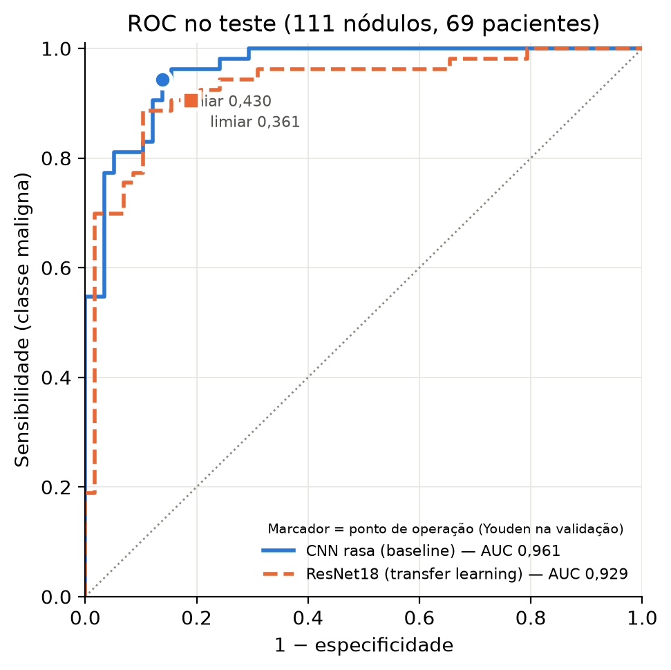

# Comparação baseline × ResNet — Issue #18

Números gerados por `python -m mineracao.comparacao` (seed 42, 2000 réplicas de
bootstrap). Saídas em `mineracao/resultados/comparacao/`: `tabela_comparativa.md`,
`resultados.json`, `roc_comparacao.png` e `predicoes_teste_pareadas.csv`.
O script não treina nem prevê: lê as predições de teste e os thresholds
congelados nos logs da #14 e da #17, confere tudo e só então calcula.

## 1. Conferência: os dois modelos foram avaliados do mesmo jeito

| Item | Baseline (#14) | ResNet (#17) |
|---|---|---|
| SHA-256 do `.npz` no log | `31a84904c9c39c97d362c46cbfef353afaecf3f531e68a90c1bfbf51d2a73fdd` | `31a84904c9c39c97d362c46cbfef353afaecf3f531e68a90c1bfbf51d2a73fdd` |
| Manifesto lido no log | `transformacao/manifest_patches.csv` | `transformacao/manifest_patches.csv` |
| Teste | 111 nódulos, 69 pacientes (53 malignos, 58 benignos) | idem, mesmos `nodule_id` |
| Threshold (Youden na validação) | 0,4305 | 0,5812 |
| Avaliações de teste no log | 1 | 1 |

- **Hash do `.npz`:** idêntico nos dois logs e igual ao `patches/patches_2_5d.npz`
  atual. A comparação vale.
- **Split:** os dois scripts leem o split da coluna `split` do manifesto via
  `mineracao/dataset.carregar_particoes`, sem sorteio próprio. O script de
  comparação passa as duas tabelas por `validar_com_manifesto` e exige que
  cubram exatamente os 111 nódulos de teste do manifesto, com os mesmos
  pacientes e rótulos. Os logs registram o caminho do manifesto, não o hash;
  o SHA-256 do manifesto atual (`207f44c7…16e4e0`) está em `resultados.json`.
- **CSV × log:** as métricas recalculadas de cada `predicoes_teste.csv` com o
  threshold do log batem exatamente com a linha `TESTE` do mesmo log, o que
  garante que predição e threshold vêm da mesma execução.
- **Teste usado uma vez:** cada modelo foi avaliado no teste uma única vez, com
  arquitetura, época e threshold congelados na validação. Este script só lê as
  predições gravadas; não reabre o teste.

> **Origem das predições do baseline.** A #14 não deixou `predicoes_teste.csv`
> no repositório (`mineracao/resultados/` está no `.gitignore`). As predições
> foram geradas nesta issue com a configuração padrão congelada da #14 —
> `python -m mineracao.treino_baseline --liberado-11 --npz patches/patches_2_5d.npz --avaliar-teste`
> (pesos de classe, flip 3D só no treino, 30 épocas, seed 42), que é a mesma
> configuração de perda e augmentation da ResNet. Nenhuma escolha foi feita
> olhando o teste. Ambiente: Python 3.13.2, torch 2.11.0 (CPU); o docstring da
> #14 cita torch 2.14.1, então pequenas diferenças numéricas são possíveis se
> outra pessoa reexecutar.

## 2. Decisão sobre independência (ameaça T7)

Os 111 nódulos vêm de 69 pacientes; 25 pacientes têm mais de um nódulo e
concentram 67 nódulos (até 6 em um paciente). **A análise agrega por paciente**:

- IC 95% de cada métrica: bootstrap percentil reamostrando pacientes
  (`avaliacao.bootstrap_por_paciente`, #15).
- IC 95% das diferenças: bootstrap **pareado** por paciente — o mesmo sorteio
  de pacientes é aplicado aos dois modelos em cada réplica.
- McNemar: versão para pares em cluster de Durkalski et al. (2003), com o
  paciente como cluster.
- DeLong: versão em cluster de Obuchowski (1997), que soma os componentes
  estruturais por paciente; reduz ao DeLong usual quando cada paciente tem um
  nódulo.

As versões por nódulo (McNemar exato e DeLong de 1988) aparecem só como
referência, marcadas como tais, porque assumem independência entre nódulos.

## 3. Tabela comparativa (teste, IC 95% por paciente)

Recall e especificidade estão no ponto de operação de cada modelo
(threshold de Youden escolhido na validação e congelado).

Os dois modelos foram avaliados sobre exatamente os mesmos 111 nódulos de teste, pertencentes a 69 pacientes.

| Métrica | CNN rasa (baseline) | ResNet18 (transfer learning) | Diferença (ResNet − baseline) |
|---|---|---|---|
| Recall (maligno) | 0,943 [0,878; 1,000] | 0,906 [0,827; 0,977] | -0,038 [-0,111; 0,034] |
| Especificidade | 0,862 [0,765; 0,946] | 0,810 [0,700; 0,902] | -0,052 [-0,172; 0,076] |
| F1 | 0,901 [0,835; 0,951] | 0,857 [0,781; 0,923] | -0,044 [-0,115; 0,027] |
| AUC-ROC | 0,961 [0,927; 0,986] | 0,929 [0,875; 0,973] | -0,032 [-0,076; 0,007] |
| Limiar (Youden, validação) | 0,4305 | 0,3614 | — |
| TP / FN / TN / FP | 50 / 3 / 50 / 8 | 48 / 5 / 47 / 11 | — |

Todas as réplicas (2000/2000) foram válidas para todas as métricas.

## 4. Testes pareados

| Teste | Estatística | p-valor |
|---|---|---|
| **McNemar em cluster por paciente** (principal) | X² = 1,32; 11 pacientes só o baseline acerta, 6 só a ResNet; 16 pacientes discordantes | **0,251** |
| McNemar exato por nódulo (referência) | b = 11, c = 6 | 0,332 |
| **DeLong em cluster por paciente** (principal) | ΔAUC = −0,032, EP 0,021, IC 95% [−0,073; 0,010], z = −1,50 | **0,133** |
| DeLong por nódulo (referência) | ΔAUC = −0,032, EP 0,020, z = −1,54 | 0,123 |

O erro-padrão em cluster é maior que o por nódulo, como esperado com nódulos
correlacionados no mesmo paciente. O IC do DeLong em cluster ([−0,073; 0,010])
é próximo ao do bootstrap pareado por paciente ([−0,076; 0,007]).

## 5. Curva ROC

Os marcadores são o ponto de operação de cada modelo (círculo: baseline;
quadrado: ResNet).

## 6. Comparação com a literatura — com ressalva

> **Ressalva obrigatória.** Nosso conjunto exige que o nódulo tenha sido marcado
> por **pelo menos 3 radiologistas** e **exclui a malignidade mediana 3**. Os
> casos ambíguos saem do problema, que fica mais fácil do que o reportado em
> trabalhos sobre o LIDC completo. O alvo também é a opinião radiológica, não
> histopatologia. Números da literatura não são diretamente comparáveis.

| Estudo | Conjunto e rótulo | Divisão | Resultado publicado |
|---|---|---|---|
| Causey et al. (2018), *Sci. Rep.* 8:9286 — NoduleX | LIDC; média dos escores arredondada; nota 3 excluída; um nódulo sorteado por paciente | 80/20 por paciente, partição única | CNN: AUC 0,974 (1 × 4–5) e 0,938 (1–2 × 4–5); com atributos radiômicos: 0,993 e 0,971 |
| Al-Shabi, Lee e Tan (2019), *IEEE Access* — Gated-Dilated | LIDC-IDRI, > 1000 exames | ver artigo | AUC > 0,95 (resumo) |

O baseline (AUC 0,961) está na mesma faixa desses trabalhos, mas as diferenças
de seleção impedem dizer que ele "empata" com eles. O desenho 1 × 4–5 de Causey
é ainda mais separado que o nosso (exclui também a nota 2); o desenho
1–2 × 4–5 é o mais próximo e não exige consenso de 3 radiologistas. Muitos
trabalhos sobre LIDC dividem por nódulo e não por paciente, o que infla o
desempenho. A tabela deve ser ampliada por quem tiver acesso ao texto completo
dos artigos, informando para cada estudo o critério de rotulagem, a divisão e
a métrica — apenas os valores conferidos na fonte foram incluídos aqui.

## 7. Texto para a seção de Resultados

> No conjunto de teste (111 nódulos de 69 pacientes; 53 malignos), a CNN rasa
> obteve AUC-ROC de 0,961 (IC 95%: 0,927–0,986) e, no limiar escolhido na
> validação, recall de 0,943 (0,878–1,000) para a classe maligna com
> especificidade de 0,862 (0,765–0,946) e F1 de 0,901 (0,835–0,951). A ResNet18
> pré-treinada no ImageNet, com `layer3` e `layer4` liberados, obteve AUC-ROC de
> 0,929 (0,875–0,973), recall de 0,906 (0,827–0,977), especificidade de 0,810
> (0,700–0,902) e F1 de 0,857 (0,781–0,923). A configuração com extrator
> congelado, avaliada anteriormente, obteve AUC de 0,827. Todos os intervalos
> foram obtidos por bootstrap reamostrando pacientes. Os dois modelos foram
> treinados sobre o mesmo arquivo de patches (SHA-256 conferido nos registros
> de execução) e avaliados no mesmo split, definido por paciente.
>
> Como os modelos foram avaliados nos mesmos nódulos, a comparação foi pareada
> e agregada por paciente para respeitar a dependência entre nódulos do mesmo
> indivíduo. A diferença de AUC (ResNet − CNN rasa) foi de −0,032 (IC 95%:
> −0,073 a 0,010; DeLong em cluster, p = 0,133). No ponto de operação, 11
> pacientes tiveram acerto apenas do baseline e 6 apenas da ResNet (McNemar em
> cluster, p = 0,251). As diferenças de recall (−0,038; IC 95%: −0,111 a
> 0,034) e especificidade (−0,052; −0,172 a 0,076) também não foram
> distinguíveis de zero.
>
> Não foi observada diferença estatisticamente significativa entre a CNN rasa e
> a ResNet18 com `layer3` e `layer4` liberados nos testes pareados. A CNN teve
> métricas pontuais maiores, mas os dados não sustentam afirmar superioridade
> estatística de um dos modelos. A configuração com extrator congelado teve
> desempenho inferior (AUC 0,827), enquanto o ajuste fino elevou a AUC para
> 0,929. Os resultados devem ser lidos à luz da seleção adotada: ao exigir
> consenso de pelo menos três radiologistas e excluir a malignidade mediana 3, o conjunto
> remove os casos ambíguos e é mais fácil que o LIDC-IDRI completo, de modo que
> os valores não são diretamente comparáveis aos de trabalhos que usam outros
> critérios.

## 8. Para a Discussão

| Modelo | Usa imagem? | AUC-ROC (teste) |
|---|---|---:|
| Diâmetro sozinho | Não | 0,9463 |
| ResNet18 congelada | Sim | 0,8269 |
| ResNet18 (`layer3` + `layer4` liberados) | Sim | 0,9294 |
| CNN rasa | Sim | 0,9610 |

- **O que foi comparado.** Foram avaliadas três configurações da ResNet18 na
  validação: backbone congelado (513 parâmetros treináveis; AUC 0,7217),
  `layer4` liberado (8.394.241 parâmetros; AUC 0,8059) e `layer3` + `layer4`
  liberados (10.493.953 parâmetros; AUC 0,8502). A escolha foi feita pelo
  recall maligno de validação, sem usar o teste. A configuração final alcançou
  AUC 0,9294 no teste, ainda abaixo do modelo de diâmetro sozinho (0,9463);
  a CNN rasa ficou em 0,9610.
- **Repetibilidade da execução final.** Duas execuções com a mesma seed e
  configuração, na CPU, divergiram a partir da segunda época: a AUC de
  validação foi 0,8502 e 0,8656. A diferença observada foi 0,0154; por isso,
  os resultados devem ser interpretados considerando essa variação numérica.
- **Limitação do BatchNorm.** Todos os módulos `BatchNorm2d`, inclusive os de
  `layer3` e `layer4`, permaneceram em modo de avaliação durante o ajuste fino.
  Os pesos dessas camadas foram treinados, mas suas estatísticas de normalização
  continuaram as do ImageNet, o que pode limitar a adaptação à tomografia.
- **Piso do diâmetro.** Mesmo com o ajuste fino, a ResNet (AUC 0,9294) não
  superou o preditor baseado apenas no diâmetro (0,9463). A CNN rasa o superou
  por 0,015. Essa comparação depende dos resultados versionados em
  `mineracao/resultados/comparacao_s5/`.

## Referências

- Causey JL et al. Highly accurate model for prediction of lung nodule malignancy with CT scans. *Sci Rep*. 2018;8:9286. doi:10.1038/s41598-018-27569-w
- Al-Shabi M, Lee HK, Tan M. Gated-Dilated Networks for Lung Nodule Classification in CT Scans. *IEEE Access*. 2019. doi:10.1109/ACCESS.2019.2958663
- DeLong ER, DeLong DM, Clarke-Pearson DL. Comparing the areas under two or more correlated ROC curves. *Biometrics*. 1988;44(3):837–845.
- Obuchowski NA. Nonparametric analysis of clustered ROC curve data. *Biometrics*. 1997;53(2):567–578.
- Durkalski VL, Palesch YY, Lipsitz SR, Rust PF. Analysis of clustered matched-pair data. *Stat Med*. 2003;22(15):2417–2428.
